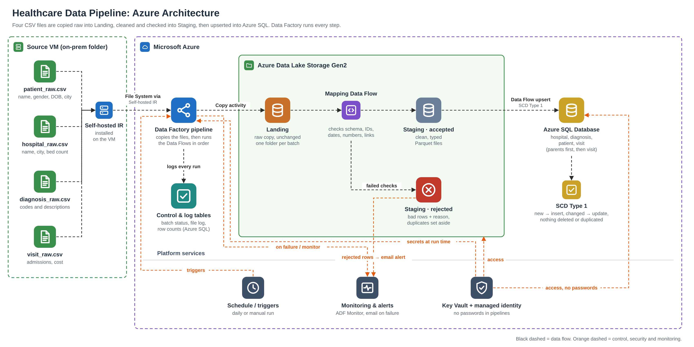

# Healthcare Data Pipeline (Azure Data Factory)

Bootcamp Project 1 · Instructor: Mallikarjun Appani

## Project overview
An end-to-end Azure pipeline for four healthcare CSV files (patient, hospital, diagnosis, visit).

**Source files (VM) → Landing (raw copy) → Staging (validated Parquet + rejected rows) → Azure SQL Database (SCD Type 1)**

- **Landing:** ADF Copy activities copy the files unchanged from a VM (via Self-hosted IR) into ADLS Gen2, one folder per batch.
- **Staging:** Mapping Data Flows apply an explicit schema, clean text, check rules, remove duplicates, check visit references, and split rows into accepted (Parquet) and rejected (with reason).
- **SQL:** Copy activities upsert accepted rows into SQL tables (insert new keys, overwrite changed ones, never delete).
- **Orchestration:** `pl_master` runs everything in order; an Azure Monitor alert emails on any failure. All passwords are in Key Vault.

## Repository structure
| Folder | Contents |
|---|---|
| `Documentation/` | `Step_X_Description.docx` for each step (steps, configuration, code snippets, challenges), source inventory and DQ rules, diagrams |
| `Code/sql/` | `create_tables.sql`, `alter_add_audit_columns.sql`, `validation_queries.sql` |
| `Code/adf/` | ADF pipeline, data flow, dataset and linked service JSON exports |
| `Code/sample_data/` | Original source files (batch 1, never edited) |
| `Code/test_data/` | Extra test files with deliberate errors (for future testing) |
| `Screenshots/` | `Step_X_Screenshot_Y.png` evidence; see `Screenshots/screenshot_checklist.md` |

## Azure resources
| Resource | Name |
|---|---|
| Resource group | rs_Bt_Anupa |
| Source VM + Self-hosted IR | vmhealthcare + shir-healthcare-vm |
| Source folder on VM | C:\Healthcaresource (files locally copied) |
| Data Factory | adf-healthcare-anupa79 |
| ADLS Gen2 storage | sthealthcareanupa79 (containers `landing`, `staging`) |
| Key Vault | kv-healthcare-anupa79 (secrets `vm-password`, `sql-password`) |
| Azure SQL | server abraham32, database sqldb-healthcare (Basic) |

## Setup steps
1. Create the resource group, VM, storage account (hierarchical namespace on) with `landing` and `staging` containers, Key Vault, Data Factory and Azure SQL database.
2. Install the Self-hosted IR on the VM, register it, and run `dmgcmd -DisableLocalFolderPathValidation` (as admin). Locally copy the four sample CSVs (received via WhatsApp; also in `Code/sample_data/`) onto the VM and save them in `C:\Healthcaresource`.
3. Add secrets `vm-password` and `sql-password` to Key Vault.
4. Give the ADF managed identity **Key Vault Secrets User** (Key Vault) and **Storage Blob Data Contributor** (storage).
5. Run `Code/sql/create_tables.sql` in the SQL Query editor (existing tables: run `alter_add_audit_columns.sql`).
6. Import the ADF objects from `Code/adf/` (ARM template import, or recreate from the JSON), then **Publish all**.
7. Create alert `alert_pipeline_failed` (Failed pipeline runs > 0) with an email action group.

## Execution order
1. Start the VM and wait until `shir-healthcare-vm` shows **Running** (about 2 minutes).
2. Trigger **`pl_master`**. It runs:
   1. `pl_ingest_landing` (VM → Landing)
   2. `pl_staging`: `df_staging_patient`, `df_staging_hospital`, `df_staging_diagnosis` in parallel, then `df_staging_visit`
   3. `pl_load_sql`: `cp_patient`, `cp_hospital`, `cp_diagnosis` in parallel, then `cp_visit`
3. Check results with `Code/sql/validation_queries.sql`.

**SCD Type 1 demo:** edit `patient_raw.csv` on the VM (P001 city → Pune, add P006), run `pl_master` again, and the patient table goes from 5 to 6 rows with P001 updated and no duplicates. A later run with the original file set P001 back to Mumbai, stamped `updated_date` / `updated_by` on P001 to P005, and kept P006 (absent rows are never deleted).

The full parameterized `pl_master` run succeeded end to end on 25 Oct 2026 (`Screenshots/Step_5_Screenshot_5.png`).

## Parameters
| Pipeline | Parameter | Meaning |
|---|---|---|
| pl_ingest_landing | `fileList` (Array) | Source file names to copy |
| pl_staging | `runId`, `runDate` | Batch id and date folder to read from Landing |
| pl_load_sql | `runId` | Batch folder to load from Staging |
| pl_master | (none) | Passes `run_ingest`'s pipeline run id as `runId` to the next two pipelines |

## Audit columns
Every SQL table has `last_updated` (created date, SQL default on insert), `updated_date` and `updated_by`. Each Copy activity adds `updated_date = @utcnow()` and `updated_by = @concat(pipeline().Pipeline, ' - ', pipeline().RunId)` as source *Additional columns*, so the upsert stamps them on every insert and update.

## Assumptions
- Business keys: patient_id, hospital_id, diagnosis_code, visit_id.
- `cost` currency is INR (not stated in the source).
- A visit with no discharge date is an open visit and is accepted.
- A record missing from a later file is kept in SQL (never deleted).

## Known limitations
- `pl_staging` and `pl_load_sql` have default `runId`/`runDate` values from the first batch. Through `pl_master` the real batch id is passed automatically (tested: parameterized `pl_master` Succeeded on 25 Oct 2026); only when running them alone must you type the right values.
- `runDate` is taken from `utcnow()` in `pl_master`; a run that crosses UTC midnight could look in the wrong date folder.
- SHIR local folder path validation is disabled to read `C:\` on the VM; production should use a network share.
- Run logging uses ADF Monitor, not a separate SQL log table.
- Plain Upsert rewrites every row in the file, so unchanged rows also get a new `updated_date` and `updated_by` on each run: `updated_date` means "last loaded", not "last changed". Rows absent from a later file are never deleted.
- The VM auto-shuts down at midnight and must be started before a run.
- The sample data had no bad rows, so rejected-row handling was shown with the sample data only (0 rejected); `Code/test_data` holds bad-data files for future testing.
- The SCD Type 1 demo used an edited `patient_raw.csv` on the VM (P001 city Mumbai → Pune, new patient P006); the original file was backed up first.

## Recovery
1. The failure alert email arrives; open ADF **Monitor > Pipeline runs** and read the error on the failed activity.
2. Fix the cause (start VM, correct file, fix expression).
3. Use **Rerun from failed activity**, or rerun `pl_staging` / `pl_load_sql` with the same `runId`.
4. Reruns are safe: each batch has its own Landing folder and SQL uses upsert, so no duplicates are created.

## Security
No passwords, keys or connection strings are stored in this repository. Linked services read secrets from Key Vault; storage uses managed identity.

## Contributors
- **Anupa** (individual project: design, build, testing and documentation)
